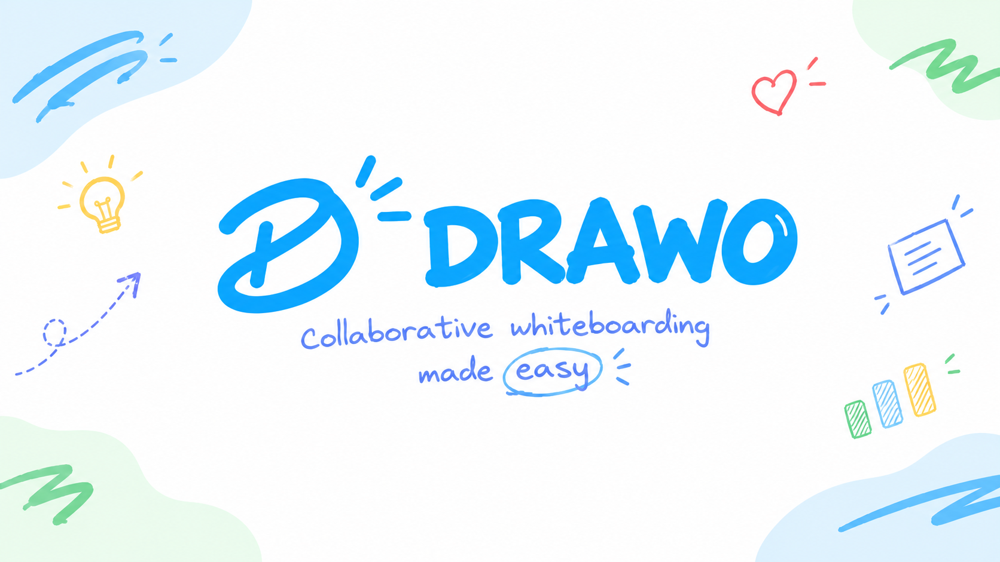

# ✏️ Drawo — Collaborative Whiteboard & Workspaces

<p align="center">
  
</p>

<p align="center">
  <strong>A modern, full-featured collaborative hand-drawn whiteboard application with multi-user Workspaces, Firebase Auth, Firestore real-time sync, and personal MCP/API keys.</strong>
</p>

<p align="center">
  <a href="#-quick-start">Quick Start</a> •
  <a href="#-features">Features</a> •
  <a href="#-hosting--deployment">Hosting Guide</a> •
  <a href="#-demo-credentials">Demo Accounts</a> •
  <a href="#-tech-stack">Tech Stack</a>
</p>

<p align="center">
  
  
  
  
  
  
</p>

---

## 🚀 Overview

**Drawo** combines the beloved sketching experience of Excalidraw with an enterprise-grade cloud workspace dashboard (inspired by Excalidraw+). It allows teams, students, and engineers to brainstorm freely on an infinite canvas, organize boards across dedicated workspaces, collaborate in real time, and integrate whiteboards into developer workflows via Model Context Protocol (MCP) personal keys.

---

## ✨ Features

### 🎨 Infinite Sketching Canvas

- **Hand-drawn feel**: Powered by Rough.js with customizable sketch roughness, stroke width, and pastel fills.
- **Rich geometry & shapes**: Rectangles, diamonds, ellipses, lines, arrows with straight, curved, or elbow bindings.
- **Interactive canvas tools**: Freehand draw, smart eraser, sticky notes, rich text, laser pointer, and element frame grouping.
- **Export options**: Export high-res PNG, SVG, or copy clean vectors directly to clipboard.

### 🏢 Multi-User Workspaces

- **Workspace Dashboard**: Modal-based workspace switcher with scene grids, search, and activity filtering.
- **Private vs. Public collections**: Keep personal drafts private or share workspace collections with teammates.
- **Workspace switching**: Instant switching between personal and team workspaces.

### 🔐 Firebase Authentication & Cloud Sync

- **Firebase Auth**: Support for Email & Password, Google OAuth, and Anonymous guest sessions.
- **Firestore Real-time Sync**: Scenes and workspace metadata persist to Google Cloud Firestore.
- **1-Click Portfolio Demo**: Instant pre-filled demo chips on the login screen for seamless reviewer access.

### 🔑 Personal MCP / API Keys

- Generate and rotate personal API keys per workspace.
- Ready-to-copy integration snippets for **Claude Desktop**, **Cursor**, and **VS Code / Antigravity**.

### ⚙️ Excalidraw+ Account Settings Suite

- **My Profile**: Custom avatar upload, profile name editor, linked accounts overview, and danger zone controls.
- **Preferences**: Theme selection (Dark / Light / System), language localization, and AI scene naming toggles.
- **Export Private Collection**: Full JSON data export and scene backup utility.
- **Fully responsive**: Polished two-column layout on desktop that gracefully collapses to an intuitive drawer on mobile devices.

---

## 🛠️ Tech Stack

| Layer | Technology |
| --- | --- |
| **Frontend Framework** | React 18, TypeScript 5 |
| **Build & Tooling** | Vite 5, SCSS, PostCSS |
| **State Management** | Jotai, React Hooks |
| **Canvas & Graphics** | Rough.js, HTML5 Canvas, SVG |
| **Backend & Cloud** | Firebase Authentication, Google Cloud Firestore, Firebase Storage |
| **Offline & PWA** | Vite PWA Plugin, Workbox Service Worker |
| **Deployment Targets** | Vercel, Netlify, Firebase Hosting, Cloudflare Pages |

---

## ⚡ Quick Start

### Prerequisites

- [Node.js](https://nodejs.org/) (v18 or v20+)
- [Corepack](https://nodejs.org/api/corepack.html) enabled (or Yarn v1.22+)

```bash
corepack enable
```

### 1. Clone & Install

```bash
git clone https://github.com/your-username/drawo.git
cd drawo
corepack yarn install
```

### 2. Run Locally

```bash
corepack yarn start
```

Open **`http://localhost:5173`** in your browser.

### 3. Production Build

```bash
corepack yarn build
```

Production assets are generated in `excalidraw-app/build`.

---

## 👥 Demo Credentials

For testing and portfolio demonstrations, the following accounts are pre-configured:

| Role | Email | Password | Quick Action |
| --- | --- | --- | --- |
| **Demo User** | `demo@drawo.app` | `drawo123456` | Click **⚡ demo@drawo.app** on login modal |
| **Admin User** | `vicheachheng001@gmail.com` | `drawo123456` | Click **⚡ vicheachheng001...** chip |
| **Owner User** | `orizyy08@gmail.com` | `drawo123456` | Manual input / Google sign-in |

---

## 🌐 Hosting & Deployment

Drawo is pre-configured for instant zero-configuration deployment to all major static and Jamstack hosts.

### Option A: Vercel (Recommended for Portfolios)

1. Push your repository to GitHub.
2. In [Vercel](https://vercel.com/), click **Add New Project** and import your repository.
3. Vercel automatically detects the root configuration (`vercel.json` already defines build commands, output directory, and SPA rewrites):
   - **Framework Preset**: Vite
   - **Build Command**: `yarn build`
   - **Output Directory**: `excalidraw-app/build`
4. Click **Deploy**.

> [!IMPORTANT] > **Firebase Authorized Domain Step**: Once Vercel assigns your URL (e.g. `https://drawo.vercel.app`), go to: **Firebase Console** → **Authentication** → **Settings** → **Authorized Domains** → **Add Domain** → enter `drawo.vercel.app`. _(Otherwise Google Sign-In will block requests from the new URL)._

### Option B: Netlify

1. Connect your repository in [Netlify](https://www.netlify.com/).
2. Netlify settings:
   - **Build command**: `yarn build`
   - **Publish directory**: `excalidraw-app/build`
3. SPA routing is automatically handled via `public/_redirects`.
4. Add your Netlify domain to Firebase Authorized Domains.

### Option C: Firebase Hosting

Deploy both Firestore security rules and the web app in one command:

```bash
# In the repository root
corepack yarn build
cd firebase-project
npx firebase-tools deploy --only hosting,firestore:rules
```

---

## 📁 Repository Structure

```
drawo/
├── excalidraw-app/                # Main web application entry point
│   ├── components/                # Workspace dashboard, account views, modals
│   ├── data/                      # Firebase auth (DrawoAuth.ts), Firestore sync
│   ├── vite.config.mts            # Vite bundler, PWA, and build config
│   └── index.html                 # HTML shell, OpenGraph & meta tags
├── packages/
│   ├── excalidraw/                # Drawing core, tools, render loop, actions
│   ├── element/                   # Shapes, arrows, frames, collision detection
│   ├── math/                      # Geometry algorithms and vector transforms
│   └── common/                    # Shared types, color constants, utility functions
├── firebase-project/              # Firebase configuration, Firestore rules & indexes
├── public/                        # Static assets, fonts, icons, _redirects
├── vercel.json                    # Vercel deployment & SPA routing rewrites
└── README.md                      # Project documentation
```

---

## 📄 License

This project is licensed under the [MIT License](LICENSE).
